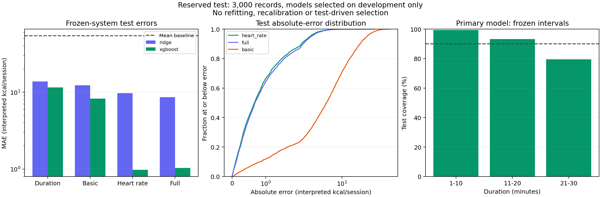

# Frozen final evaluation

Item 8 snapshot — 11 October 2026. **All 63 tests and independent output checks passed.** The reserved 3,000-row test partition has now been evaluated for the nine previously fitted systems. This milestone performed **zero estimator fits and zero interval-quantile refits**. Earlier reports retain their dated, development/audit-only scope.

## Research outcome

**Temperature can be omitted under the predefined benchmark rule when heart rate is available; removing both sensors fails that rule.** This conclusion applies to the evaluated pipelines and supplied recorded labels, not to physiological calorie-measurement accuracy or deployment usefulness.

The primary system is **XGBoost with Gender, Age, Height, Weight, Duration and Heart_Rate**, without Body_Temp. It was selected by the lowest recorded development mean-fold MAE before test release, using the item 7 rule. Its test MAE is **0.978**, RMSE **1.576**, and p95 absolute error **2.985**, in interpreted kcal/session. Full-input XGBoost test MAE is **1.032**. The primary choice was not changed after seeing test results.

The heart-rate versus full XGBoost relative MAE change is **−5.22%**, with an approximate paired 95% percentile bootstrap interval **[−6.52%, −3.82%]**. Its upper bound is below the predefined +10% degradation margin. Basic versus full XGBoost is **+698.76%**, interval **[+664.34%, +736.10%]**, failing the same rule. Both reduced-input Ridge comparisons also fail. A negative relative change means lower observed MAE for the reduced system; this is not a regression “accuracy percentage.”

**Reliability remains limited:** the primary model's fixed 90%-nominal interval covered **90.67%** overall, but **79.54%** of 21–30 minute sessions. The item 7 simulated-noise failure remains relevant and was not repaired through test-driven changes.



## Selection and release record

Implementation and plan v1.5 were committed at `42f5424111825a2ac9828c715fab16a4106b0077` before test release. The [selection manifest](FINAL_SELECTION.json) records development scores, the primary system, exact pipeline/interval hashes and code/configuration/plan fingerprints. Selection sorts the eight Ridge/XGBoost systems by development mean-fold MAE, then fewer fields, then model name. The mean baseline is retained as a sanity comparator rather than a selectable primary system.

After source-run and interval checks, a manifest was saved before test analysis frames or predictions, followed by exclusive creation of local `runs/final-test-access.json`. This record binds the test release to its frozen manifest and blocks another evaluation command, including a different run directory. Integrity checks read the complete CSV for hashes/schema, as in earlier milestones; the workflow rule is not an access-control boundary.

The 8,999 development / 3,000 calibration / 3,000 test assignments are unchanged. Saved pipelines remain fitted on development only. All eight interval thresholds come unchanged from the 1,500 interval-fit observations in item 7; neither the 1,500 interval-audit labels nor test labels are incorporated into another threshold fit. Predictions and bounds are unclipped. No test score selects a new feature set, hyperparameter, seed, model or interval method.

## All frozen point predictors

Each system predicts the same 3,000 test records. Errors use interpreted kcal/session. Development MAE is the previously recorded unweighted mean of five folds and was used for selection; test MAE is the pooled held-out result. Different tuning budgets limit cross-family interpretation. Fields count available columns, not measured cost or usability burden.

| Frozen system | Input fields | Development mean-fold MAE | Test MAE | Test RMSE | Test p95 absolute error |
| --- | ---: | ---: | ---: | ---: | ---: |
| mean | 0 | 52.833 | 54.236 | 63.511 | 110.401 |
| ridge_duration | 1 | 13.298 | 13.798 | 18.795 | 39.109 |
| ridge_basic | 5 | 11.988 | 12.294 | 16.307 | 32.342 |
| ridge_heart_rate | 6 | 9.558 | 9.738 | 12.851 | 25.323 |
| ridge_full | 7 | 8.303 | 8.613 | 11.647 | 23.124 |
| xgboost_duration | 1 | 11.313 | 11.508 | 16.953 | 36.196 |
| xgboost_basic | 5 | 8.242 | 8.240 | 11.723 | 25.683 |
| xgboost_heart_rate | 6 | 1.080 | 0.978 | 1.576 | 2.985 |
| xgboost_full | 7 | 1.117 | 1.032 | 1.645 | 3.121 |

All point differences against the same family's full-input system, including diagnostic duration-only differences, are in [FINAL_EVALUATION_METRICS.json](FINAL_EVALUATION_METRICS.json). The mean uses no input fields and predicts the saved development-target mean. Some Ridge predictions and four basic-XGBoost predictions are negative; the JSON records counts and no clipping was introduced after evaluation.

## Four planned paired comparisons

Resample test records with replacement 2,000 times using seed 2026 and exactly the same row indices for both models and all four pairs. For each draw calculate `(MAE_reduced − MAE_full) / MAE_full`; use the 2.5th/97.5th percentiles with linear interpolation. The 10% operational rule is `competitive` when the interval upper bound is <= +10%, `fails_margin` when its lower bound is > +10%, otherwise `inconclusive`. No relative denominators were zero in this run. Absolute-change intervals are supplemental and included in the JSON.

| Planned reduced vs full comparison | Absolute MAE change | Relative MAE change | Approximate paired 95% interval | Benchmark decision |
| --- | ---: | ---: | --- | --- |
| ridge_basic vs ridge_full | +3.681 | +42.74% | [+38.59%, +47.02%] | fails_margin |
| ridge_heart_rate vs ridge_full | +1.125 | +13.06% | [+11.07%, +15.18%] | fails_margin |
| xgboost_basic vs xgboost_full | +7.208 | +698.76% | [+664.34%, +736.10%] | fails_margin |
| xgboost_heart_rate vs xgboost_full | -0.054 | -5.22% | [-6.52%, -3.82%] | competitive |

These intervals describe variation in the evaluated observations conditional on the frozen fitted systems. Row resampling assumes exchangeable observations; unknown collection and unrecorded participant dependence limit interpretation. They do not include training uncertainty, establish population noninferiority, or certify a sensor is unnecessary in another dataset. No multiple-comparison significance claim is made. Paired and percentile conventions are described in [SciPy's bootstrap documentation](https://docs.scipy.org/doc/scipy/reference/generated/scipy.stats.bootstrap.html); this run uses the explicit NumPy construction fixed in the plan, not SciPy's default BCa method.

## Frozen interval results

Every interval below has a nominal level of 90%, with its width fixed before test release. Overall empirical coverage differs from the nominal level because these are finite samples. It does not imply coverage for each person or subgroup. Widths use interpreted kcal/session.

| Frozen system | Test coverage | Constant full width | Negative lower bounds |
| --- | ---: | ---: | ---: |
| ridge_duration | 89.13% | 57.245 | 571 |
| ridge_basic | 89.33% | 49.437 | 557 |
| ridge_heart_rate | 87.97% | 35.823 | 477 |
| ridge_full | 87.30% | 32.885 | 441 |
| xgboost_duration | 89.33% | 53.706 | 571 |
| xgboost_basic | 89.10% | 38.163 | 403 |
| xgboost_heart_rate | 90.67% | 4.457 | 9 |
| xgboost_full | 89.97% | 4.566 | 8 |

The primary interval is prediction ± **2.228363**, full width **4.456726**. It contains 2,720 of 3,000 test labels. Nine primary lower bounds are below zero, retained and counted without hidden postprocessing.

## Primary-system group diagnostics

These are descriptive results for the file's represented categories and predefined bands. Counts matter: overall coverage can conceal substantial subgroup gaps. No subgroup-specific recalibration, intersectional fairness or causal conclusion is made. The JSON includes the corresponding results for every frozen system.

| Recorded group | Test n | MAE | RMSE | p95 absolute error | Interval coverage |
| --- | ---: | ---: | ---: | ---: | ---: |
| gender: female | 1522 | 0.770 | 1.101 | 2.276 | 94.88% |
| gender: male | 1478 | 1.192 | 1.948 | 3.564 | 86.33% |
| age: 20-39 | 1540 | 0.839 | 1.210 | 2.489 | 93.44% |
| age: 40-59 | 873 | 1.047 | 1.488 | 3.205 | 88.20% |
| age: 60-79 | 587 | 1.238 | 2.360 | 3.618 | 87.05% |
| duration: 1-10 | 971 | 0.474 | 0.631 | 1.256 | 99.38% |
| duration: 11-20 | 1032 | 0.946 | 1.278 | 2.512 | 93.22% |
| duration: 21-30 | 997 | 1.501 | 2.323 | 3.942 | 79.54% |

Longer-session error and coverage gaps persist: 21–30 minute sessions have MAE 1.501 and coverage 79.54%, compared with MAE 0.474 and coverage 99.38% for 1–10 minutes. Overall coverage therefore does not establish balanced reliability. The earlier independent audit found the same direction of failure; it was documented without changing the frozen system. Any attempt to address it would be a separate disclosed experiment requiring new independent evidence.

## Verification and local artifacts

The 63-test suite includes development-only selection and tie handling, agreement with an independent SciPy paired-percentile bootstrap calculation, proportional-error pairing, zero-denominator behavior, exact margin boundaries, test-only loading, frozen model/interval binding and repeat-release prevention. The full setup workflow passed before release.

Independent checks on this actual run verified all 3,000 IDs/labels and saved-pipeline prediction parity; recomputed all nine systems' point/group/coverage metrics; regenerated the complete 2,000-row-resample matrix; recomputed each pair using multinomial row counts; and checked every percentile interval and margin decision. They verified the pre-test commit's source fingerprints, source-run/model/threshold hashes, global assignments, historical report contents and original notebook/CSV integrity. Verification recomputes the same frozen results; it does not fit, retune or create a new test-selection experiment.

Local ignored `runs/final-evaluation-v1/` contains `selection_manifest.json`, `test_predictions.csv`, `paired_bootstrap.npz`, full metrics, the figure and `verification.json`. The separate test-release record remains intact. Tracked artifacts contain the frozen selection manifest, aggregate metrics and the figure; IDs, labels, bootstrap row draws, per-record predictions and fitted pipelines remain local. Python 3.12.14, scikit-learn 1.8.0, XGBoost 2.0.3, one CPU thread; complete versions and fingerprints are in the metrics.

The command for a first release, after the matching frozen source runs exist, is:

```powershell
& .\scripts\final-evaluate.ps1
```

This checkout has already completed that release, so the command now refuses another run. Inspect saved results rather than deleting the release record. The final runner deliberately requires the original verified reliability snapshot and bound source runs; the source ZIP excludes these private artifacts. Recreating earlier experiments produces new timestamped run reports, so raw CSV alone does not satisfy this release's exact source bindings. Such reconstruction must retain its own verified aggregate snapshot and disclose it as a new reproduction, rather than editing hashes to impersonate this release.

## Scope and next milestone

This dataset was explored in the original notebook before the research revision. The controlled reserved-test workflow strengthens the new comparison but does not create untouched external evidence. Original collection, recorded calorie-label construction, interpreted units and dataset licensing remain unresolved. Results show benchmark agreement, not validated energy expenditure, health benefit or measured user impact.

Item 8 is complete. Item 9 is a demo that loads these frozen artifacts, validates inputs, routes missing sensors to the appropriate reduced-input system and communicates the observed interval and sensor-noise limitations. The primary remains heart-rate XGBoost; basic inputs are an explicitly less accurate fallback. User benefit still requires the planned usability study.
