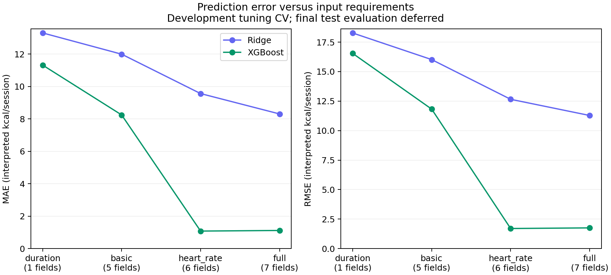

# Prediction error versus input requirements

Item 6 snapshot — 10 October 2026. The matched XGBoost comparison is complete. **All 42 tests passed.** All results below use development data; calibration and test fitting/scoring remain deferred.

## Development results

Five shared folds on 8,999 records; scores are unweighted means of validation-fold MAE/RMSE. Lower error is better. Units are interpreted kcal/session, with undocumented original label generation. Both families' selected scores reuse their tuning folds and may be optimistic after selection. These are not test scores.

| Algorithm | Input set | Fields | Mean-fold MAE | Mean-fold RMSE | MAE change vs same algorithm, full |
| --- | --- | ---: | ---: | ---: | ---: |
| ridge | duration | 1 | 13.298 | 18.274 | +60.2% |
| ridge | basic | 5 | 11.988 | 16.021 | +44.4% |
| ridge | heart_rate | 6 | 9.558 | 12.656 | +15.1% |
| ridge | full | 7 | 8.303 | 11.284 | +0.0% |
| xgboost | duration | 1 | 11.313 | 16.543 | +912.4% |
| xgboost | basic | 5 | 8.242 | 11.822 | +637.6% |
| xgboost | heart_rate | 6 | 1.080 | 1.702 | -3.3% |
| xgboost | full | 7 | 1.117 | 1.755 | +0.0% |



Duration is session duration alone. Basic adds recorded gender, age, height and weight. Heart-rate adds heart rate to basic; full also includes body temperature. Counts describe input fields, not independently measured sensor cost or user effort. All inputs describe a recorded session, so this is after-session estimation rather than prediction of a future workout.

For XGBoost, omitting temperature changes development MAE from 1.117 to 1.080 (-3.3%). Omitting both heart rate and temperature changes MAE to 8.242 (+637.6%). These comparisons quantify the trade-off observed here; they do not justify a competitiveness decision under the planned 10% final-test rule. That decision requires the reserved test predictions and paired interval after choices are frozen.

Ridge received six alpha settings per input set and XGBoost received 30 configurations. The cross-family comparison is descriptive with unequal search budgets. Within each family the budgets, observations and folds match across input sets. The mean sanity baseline's development MAE remains 52.833.

## Search and model artifacts

Experiment plan v1.3 fixed the finite search space before XGBoost benchmark fitting. Search seed 44 sampled 30 unique configurations without replacement. Every input set received the identical ordered sample and model seed 45. Models used squared-error loss, histogram trees, one CPU thread, unscaled numeric features and schema-defined gender encoding. There was no early stopping or evaluation set. Selection used mean-fold MAE with the lower candidate index breaking exact ties.

The run completed 600 CV fits and four development refits. Selected settings:

- `duration`: candidate 23 (zero-based), `{"colsample_bytree": 0.8, "learning_rate": 0.03, "max_depth": 6, "min_child_weight": 1, "n_estimators": 200, "reg_alpha": 1.0, "reg_lambda": 5.0, "subsample": 1.0}`.
- `basic`: candidate 19 (zero-based), `{"colsample_bytree": 1.0, "learning_rate": 0.05, "max_depth": 4, "min_child_weight": 10, "n_estimators": 400, "reg_alpha": 0.0, "reg_lambda": 10.0, "subsample": 0.8}`.
- `heart_rate`: candidate 21 (zero-based), `{"colsample_bytree": 1.0, "learning_rate": 0.1, "max_depth": 6, "min_child_weight": 5, "n_estimators": 600, "reg_alpha": 1.0, "reg_lambda": 1.0, "subsample": 1.0}`.
- `full`: candidate 21 (zero-based), `{"colsample_bytree": 1.0, "learning_rate": 0.1, "max_depth": 6, "min_child_weight": 5, "n_estimators": 600, "reg_alpha": 1.0, "reg_lambda": 1.0, "subsample": 1.0}`.

The four saved pipelines were refitted on development only and reloaded with identical predictions. Negative development OOF predictions: xgboost_duration: 0, xgboost_basic: 11, xgboost_heart_rate: 2, xgboost_full: 1. No prediction clipping was applied. Tail-error diagnostics are included in the aggregate JSON. Item 7 will investigate reliability; subgroup analysis and uncertainty coverage have not been completed yet.

## Prediction timing

Same machine/environment for both saved families, one CPU thread, 10 warm-ups and 100 timed prediction calls per batch. Batches use the first 1 or 100 development rows in canonical ID order. Timing includes pipeline transformations and prediction, excludes model loading and input parsing, and uses a high-resolution monotonic clock. Models were timed in Ridge then XGBoost order; this is a machine-specific diagnostic, not production service latency.

| Saved model | 1 row: median / p95 ms | 100 rows: median / p95 ms |
| --- | ---: | ---: |
| ridge_duration | 2.348 / 3.741 | 2.266 / 3.180 |
| ridge_basic | 4.360 / 7.839 | 4.936 / 7.555 |
| ridge_heart_rate | 3.407 / 5.166 | 3.621 / 6.210 |
| ridge_full | 3.411 / 6.266 | 5.600 / 8.515 |
| xgboost_duration | 2.135 / 3.404 | 2.474 / 3.525 |
| xgboost_basic | 4.241 / 5.865 | 5.075 / 8.948 |
| xgboost_heart_rate | 3.727 / 5.095 | 5.968 / 8.367 |
| xgboost_full | 4.256 / 6.138 | 6.664 / 9.425 |

Python 3.12.14, XGBoost 2.0.3, scikit-learn 1.8.0, AMD64. Full platform, package versions, per-fit times, candidates and fold scores are in [INPUT_COMPARISON_METRICS.json](INPUT_COMPARISON_METRICS.json). Fewer fields are not a measured energy, monetary or usability saving.

## Reproduce

After the documented environment setup and data staging, run:

```powershell
& .\scripts\compare-inputs.ps1
```

This validates/prepares data and frozen folds, creates the baseline run if missing, validates its saved hashes/IDs/labels/folds/scores, then runs the nonlinear search and timing. Existing run directories are preserved. To repeat, choose `-RunDirectory runs/input-comparison-repeat-1`. An alternate baseline directory is accepted through `-BaselineRunDirectory`; its dataset, features, fold protocol and saved predictions must match.

Local `runs/input-comparison-v1/` contains the pre-fit search manifest, complete metrics, four joblib pipelines, selected development OOF predictions, PNG/SVG figures and independent verification. Per-record data/predictions and fitted artifacts remain Git-ignored. Only aggregate metrics and figures are tracked for publication. The historical baseline report retains its item 5 source fingerprints; it is deliberately reused rather than silently overwritten by this milestone.

## Verification and interpretation limits

All 42 synthetic tests passed, including deterministic unique search sampling, numeric-unit preservation, pipeline persistence, same-algorithm comparison arithmetic, and rejection of mismatched baseline predictions/protocol/features. Independent checks on the actual run recomputed selected fold/pooled errors, selection and relative-change arithmetic; verified the identical 30-candidate search in all four sets, saved model settings and hashes, latency record structure, and unchanged original files, baseline artifacts and frozen assignments.

No calibration or test labels entered fitting, selection, timing inputs or scoring. Integrity validation reads the full CSV for hash/schema checks. The benchmark was already explored in the original notebook; data provenance, label method, license and interpreted units remain unresolved. These results demonstrate a reproducible comparative experiment, not external validity, causal sensor value, real-world calorie accuracy or measured user impact.

Next: item 7, development reliability diagnostics and a documented uncertainty method using the reserved calibration partition. Final test evaluation and the final system decision remain later work; the item 6 search consumes the planned XGBoost budget rather than creating a second search in item 8.
