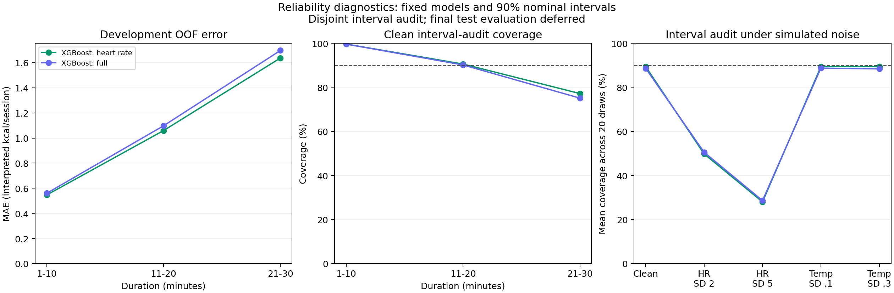

# Reliability, sensor noise and prediction intervals

Item 7 snapshot — 11 October 2026. **All 52 tests passed.** Reliability diagnostics and interval calibration/auditing are complete. The reserved 3,000-row test set has not been evaluated. Models, input sets and search settings were preserved.

## Findings

The development-selected XGBoost heart-rate model has a small clean error but clear limitations:

- Its 90%-nominal interval covered **89.4%** of 1,500 disjoint interval-audit records. The fixed half-width is **2.228 interpreted kcal/session**, so the full width is 4.457.
- Coverage differs substantially by duration: **99.6%** on 1–10 minute sessions (n=520) versus **77.2%** on 21–30 minute sessions (n=482). The constant-width interval does not provide balanced subgroup coverage.
- Simulated Gaussian heart-rate noise with SD 5 bpm raises mean development OOF MAE from **1.080 to 7.777** and lowers mean audit coverage to **28.0%**. This is a chosen stress-test scenario, not a measured device-error distribution.
- Removing temperature makes the heart-rate model unaffected by simulated temperature noise. The full model shows a small change under temperature noise and similar heart-rate sensitivity in these scenarios.

These are reproducible benchmark diagnostics. Low average error does not establish reliable intervals for every group or robustness to measurement changes. Source provenance, target construction and interpreted units remain unresolved; no health or user-impact claim follows.



## Separate roles for fitting and checking intervals

The original 8,999 development / 3,000 calibration / 3,000 test allocation is unchanged. The calibration partition now has two fixed roles: **1,500 interval-fit** and **1,500 interval-audit** observations. ID-only SHA-256 ranking with seed 46 assigned roles before calibration labels were used for analysis. The roles and pre-analysis manifest are saved locally and hashed.

All eight selected pipelines stay fitted on development only. For each pipeline, the split-conformal score is absolute residual on interval-fit records. The threshold is the **1,351st sorted residual** (one-based): `ceil((1500+1)*0.90)`. There is no interpolation or clipping. The interval is the saved prediction plus/minus this fixed threshold. Thresholds are bound to exact pipeline hashes in local `intervals.json` and frozen for final testing; the audit labels will not be incorporated into another quantile fit.

This method targets marginal coverage under exchangeability of calibration and future observations for a predictor fitted independently of calibration. It does not guarantee coverage per subgroup or under distribution shift. See [Angelopoulos and Bates, A Gentle Introduction to Conformal Prediction](https://arxiv.org/abs/2107.07511). The disjoint audit estimates coverage with sampling variation; it is not the final test. No calibration-fit coverage is presented as independent validation.

## Clean interval-audit results

Every row below uses the same 1,500 audit observations. MAE is point-prediction error on this audit subset, distinct from earlier development tuning MAE. Interval widths and errors use interpreted kcal/session. Overall empirical coverage below 90% is reported as observed without recalibration or claims of statistical significance.

| Frozen model | Audit MAE | Audit coverage | Half-width | Full width |
| --- | ---: | ---: | ---: | ---: |
| ridge_duration | 13.866 | 89.2% | 28.622 | 57.245 |
| ridge_basic | 12.186 | 88.4% | 24.718 | 49.437 |
| ridge_heart_rate | 9.628 | 88.2% | 17.911 | 35.823 |
| ridge_full | 8.274 | 88.1% | 16.443 | 32.885 |
| xgboost_duration | 11.608 | 89.9% | 26.853 | 53.706 |
| xgboost_basic | 8.276 | 89.8% | 19.082 | 38.163 |
| xgboost_heart_rate | 1.006 | 89.4% | 2.228 | 4.457 |
| xgboost_full | 1.058 | 88.6% | 2.283 | 4.566 |

## Group diagnostics

Development group errors use the saved selected out-of-fold predictions on 8,999 rows; the all-development model is never scored on its own training observations as a generalization estimate. Hyperparameter selection reused these folds, so the errors remain exploratory tuning diagnostics. Audit coverage uses the independent interval-audit subset. The two sample counts are deliberately distinct.

| Model | Recorded group | Development n | OOF MAE | OOF p95 absolute error | Audit n | Audit coverage |
| --- | --- | ---: | ---: | ---: | ---: | ---: |
| xgboost_heart_rate | gender: female | 4544 | 0.847 | 2.531 | 724 | 94.2% |
| xgboost_heart_rate | gender: male | 4455 | 1.318 | 3.924 | 776 | 84.9% |
| xgboost_heart_rate | age: 20-39 | 4483 | 0.939 | 2.747 | 738 | 93.9% |
| xgboost_heart_rate | age: 40-59 | 2629 | 1.125 | 3.414 | 461 | 86.1% |
| xgboost_heart_rate | age: 60-79 | 1887 | 1.352 | 4.303 | 301 | 83.4% |
| xgboost_heart_rate | duration: 1-10 | 2906 | 0.546 | 1.523 | 520 | 99.6% |
| xgboost_heart_rate | duration: 11-20 | 3187 | 1.059 | 2.797 | 498 | 90.6% |
| xgboost_heart_rate | duration: 21-30 | 2906 | 1.637 | 4.592 | 482 | 77.2% |
| xgboost_full | gender: female | 4544 | 0.882 | 2.594 | 724 | 94.5% |
| xgboost_full | gender: male | 4455 | 1.358 | 4.087 | 776 | 83.1% |
| xgboost_full | age: 20-39 | 4483 | 0.966 | 2.803 | 738 | 93.0% |
| xgboost_full | age: 40-59 | 2629 | 1.169 | 3.694 | 461 | 84.6% |
| xgboost_full | age: 60-79 | 1887 | 1.405 | 4.312 | 301 | 84.1% |
| xgboost_full | duration: 1-10 | 2906 | 0.560 | 1.537 | 520 | 99.6% |
| xgboost_full | duration: 11-20 | 3187 | 1.097 | 2.989 | 498 | 90.2% |
| xgboost_full | duration: 21-30 | 2906 | 1.697 | 4.738 | 482 | 75.1% |

All eight models' group MAE, RMSE, p95 errors, audit errors/coverage and counts are in [RELIABILITY_METRICS.json](RELIABILITY_METRICS.json). Group differences describe this file's recorded categories and session distribution; they do not establish discrimination, causal effects or performance for unrepresented populations. No subgroup-specific interval adjustment was learned from the audit.

## Paired sensor stress tests

For each condition, 20 standard-normal draws per record are shared across model families, input sets and magnitudes for that sensor. Seed 47 uses separate deterministic streams for development and interval audit. One sensor is perturbed at a time; labels, other inputs and thresholds remain fixed. Inputs are not rounded or clipped. Fractions outside the development feature ranges are recorded in the JSON.

The eight selected settings were replayed on the five original development folds (**40 fits, zero search fits**). Clean replay predictions matched saved OOF values to within 1e-10. Noisy predictions use each validation fold's fitted model. Audit stress tests reuse the saved development-fitted pipelines. A model that omits a sensor remains unchanged when that sensor is perturbed.

| Model | Simulated condition | Mean OOF MAE | MAE SD across 20 draws | Mean audit coverage |
| --- | --- | ---: | ---: | ---: |
| xgboost_heart_rate | Clean | 1.080 | — | 89.4% |
| xgboost_heart_rate | heart_rate_sd_2 | 3.474 | 0.034 | 49.8% |
| xgboost_heart_rate | heart_rate_sd_5 | 7.777 | 0.076 | 28.0% |
| xgboost_heart_rate | temperature_sd_0.1 | 1.080 | 0.000 | 89.4% |
| xgboost_heart_rate | temperature_sd_0.3 | 1.080 | 0.000 | 89.4% |
| xgboost_full | Clean | 1.117 | — | 88.6% |
| xgboost_full | heart_rate_sd_2 | 3.487 | 0.033 | 50.6% |
| xgboost_full | heart_rate_sd_5 | 7.777 | 0.076 | 28.6% |
| xgboost_full | temperature_sd_0.1 | 1.119 | 0.002 | 88.7% |
| xgboost_full | temperature_sd_0.3 | 1.130 | 0.003 | 88.4% |

Draw standard deviations summarize variation between simulated noise realizations; they are not confidence intervals. Clean and noisy audit interval widths stay constant for each model. Coverage under artificial noise is a stress diagnostic, with no conformal coverage promise under that shift. Sensor standard deviations are chosen scenarios rather than validated measurement specifications. Missing sensors must route to a separately fitted reduced-input model, not be replaced with zero; this milestone verifies sensor omission through those models, without adding a demo interface.

## Frozen decisions and implications

Before reading calibration results, experiment plan v1.4 fixed final primary-model selection to lowest recorded development mean-fold MAE across the eight systems, with exact ties broken by fewer fields then model name. That rule favors XGBoost with heart rate and without temperature based on item 6. Neither these audit results nor subgroup/noise results choose another model or change the interval method.

The long-session coverage gap and noise sensitivity remain documented limitations of the frozen system. Addressing them with a redesigned interval method or new model would be a separate experiment requiring fresh independent evidence. The demo must communicate the interval assumptions and observed failures, and cannot present these estimates as validated calorie measurements. Unclipped intervals can extend below zero; the heart-rate model has 5 negative lower bounds among the audit records. No hidden postprocessing was applied.

## Reproduce and inspect

After the setup, data staging and item 6 comparison:

```powershell
& .\scripts\reliability.ps1
```

The script runs environment/data/tests/preparation checks, verifies frozen assignments and source runs, and creates the analysis. It does not repeat the hyperparameter search. Existing run directories are preserved; use `-RunDirectory runs/reliability-repeat-1` to repeat. Optional `-BaselineRunDirectory` and `-ComparisonRunDirectory` must identify matching frozen runs.

Local, Git-ignored `runs/reliability-v1/` contains calibration roles, the pre-analysis manifest, model-bound interval thresholds, compressed per-record clean/noisy predictions, complete metrics, a figure and independent verification. Source model artifacts are reused and preserved. Only aggregate metrics and the figure are tracked for publication; IDs, labels, prediction arrays and fitted artifacts remain private local files.

The 52-test suite checks exact finite-sample ranks including an infinite-threshold edge case, disjoint role allocation, rejection of test/cross-partition requests, inclusive interval boundaries, group-band coverage, deterministic independent noise streams, no effect from unused sensors and noise-summary arithmetic. Independent checks on the actual run recomputed every threshold from interval-fit labels only; all clean, subgroup and noise metrics; role allocation and separation; saved model/analysis hashes; and noise range/no-op behavior. Original source files, model artifacts and global assignments are unchanged. Integrity validation reads the full CSV for hash/schema checks, but test observations are excluded from analysis frames and scoring.

Python 3.12.14, scikit-learn 1.8.0, XGBoost 2.0.3, one CPU thread. Package versions, code/configuration fingerprints and provenance hashes are in the aggregate JSON. Next: item 8, freeze the primary system and evaluate the reserved test once, including the preplanned paired input comparisons and interval coverage. No new search or audit-driven redesign is planned.
